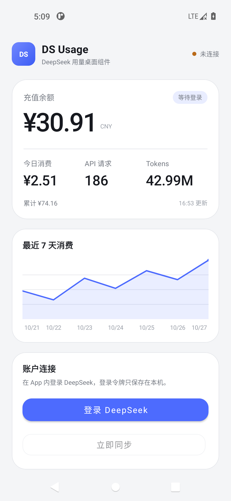
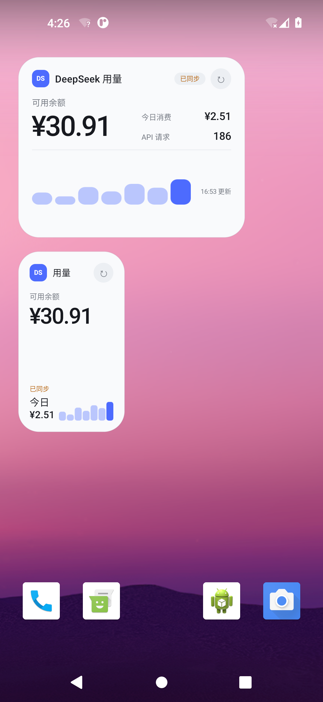

# DS Usage

[](https://github.com/vincent-1223/dsusage/actions/workflows/android.yml)

一个本地优先的 Android 桌面小组件，用来展示 DeepSeek 账户的余额、当日消费、API 请求次数、Tokens 和最近 7 天消费趋势。

项目不包含服务器，不需要注册 DS Usage 账号，也不会上传或管理用户数据。用户在自己的设备上登录 DeepSeek，登录令牌经 Android Keystore 加密后只保存在本机。

> 本项目不是 DeepSeek 官方产品，与 DeepSeek 没有隶属关系。用量数据来自 DeepSeek 网页端内部接口，接口调整后可能需要更新适配。

<p align="center">
  
  
</p>

## 功能

- 内嵌 DeepSeek 登录页，登录态只保存在本机
- 可用余额、累计消费、今日消费、API 请求、Tokens
- 最近 7 天消费趋势
- 2×2、4×2、4×4 三种桌面小组件
- 每 30 分钟自动同步，支持手动刷新
- 登录过期时保留上次缓存，并提示重新登录
- 浅色与深色主题
- 无后端、无统计 SDK、无云端账号

## 安装

从 [Releases](https://github.com/vincent-1223/dsusage/releases/latest) 下载最新 `dsusage-v1.0.1.apk`，在 Android 8.0 及以上设备安装。

首次打开：

1. 点击“登录 DeepSeek”。
2. 在 App 内完成 DeepSeek 登录。
3. 返回首页确认数据同步成功。
4. 点击 2×2、4×2 或 4×4 添加桌面小组件。

部分启动器不支持 App 内直接添加组件。此时长按桌面，进入“小组件”，搜索 `DS Usage`，再手动拖到桌面。

## 数据与隐私

App 只请求以下网页接口：

```text
/api/v0/users/get_user_summary
/api/v0/usage/by_api_key/cost?start=<start>&end=<end>&tz=<offset>
/api/v0/usage/by_api_key/amount?start=<start>&end=<end>&tz=<offset>
```

不请求充值、退款、发票、API Key 管理等无关数据。网页登录令牌与用量缓存只写入应用私有存储，令牌额外使用 Android Keystore AES-GCM 加密。应用关闭备份，且不包含分析或崩溃上报服务。

## 已知限制

- DeepSeek 网页内部接口不是稳定公开 API，平台更新后可能暂时失效。
- 第三方登录是否能在嵌入式 WebView 中完成，取决于 DeepSeek 和对应身份提供商当时的策略。
- 登录态过期后必须由用户重新完成网页登录。
- Android 后台任务会受系统省电策略影响，桌面数据不是实时数据。

## 本地构建

要求：

- JDK 17 或以上
- Android SDK 35
- Android Build Tools 35.0.0

```bash
./gradlew testDebugUnitTest assembleRelease
```

生成文件：

```text
app/build/outputs/apk/release/app-release.apk
```

当前 GitHub Release APK 使用开发签名，便于直接安装和早期测试，不用于 Google Play 发布。

## 技术栈

- Kotlin
- Android Views / RemoteViews
- WorkManager
- OkHttp
- Android Keystore
- WebView

## License

[MIT](LICENSE)

